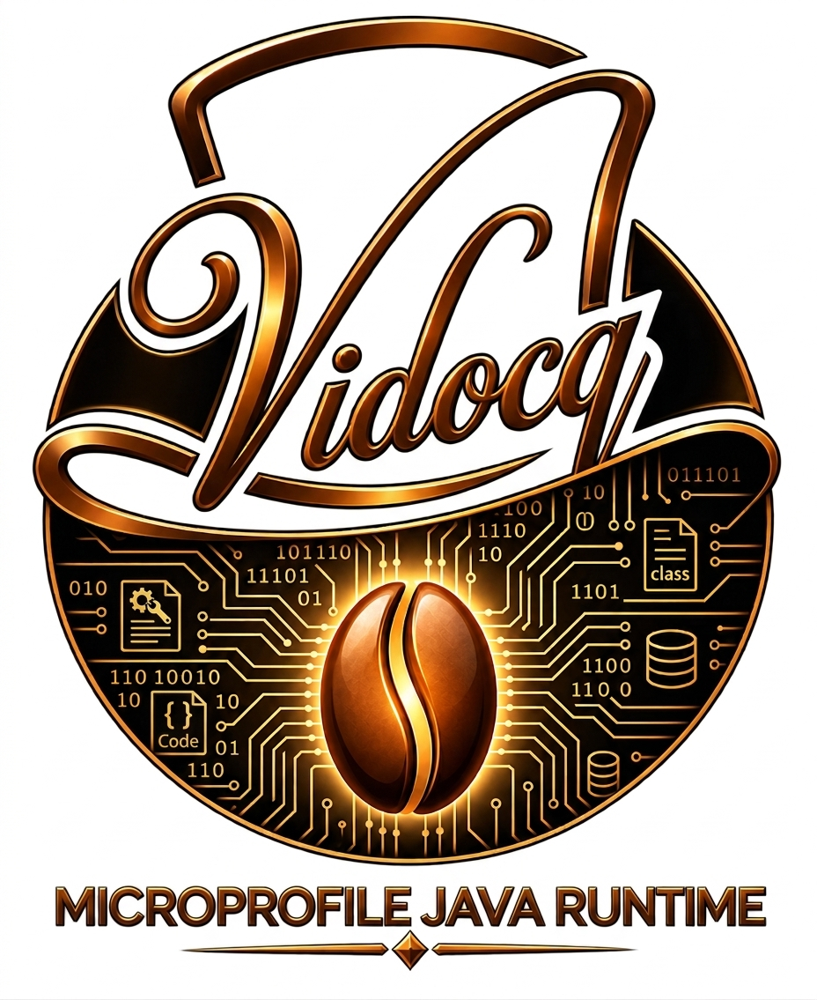

<p align="center">
  
</p>

<h1 align="center">Vidocq</h1>

<p align="center">
  <strong>A modular Java SE runtime for Jakarta EE and MicroProfile</strong><br>
  JDK 25 | Java Modules | CDI 4.1 Lite | MicroProfile 7.2
</p>

<p align="center">
  
  
  
</p>

---

## What is Vidocq?

Vidocq is a Java SE application runtime assembled from independent implementations of the Jakarta EE and
MicroProfile specifications, one per specification, each usable alone. This repository holds all of them, their
shared parent, the runtime that assembles them, and its tooling (Maven plugin, CLI, dev mode).

- **Java Modules everywhere**: every module declares a `module-info.java`; no class path is required.
- **Build-time generation**: proxies, interceptors and wiring are generated at compile time with the JDK 25
  Class-File API and annotation processors, not by runtime reflection.
- **No third-party runtime dependency**: a published module depends only on the specification APIs it implements.
- **Virtual threads** for every I/O path.

## Repository layout

```
vidocq/
├── pom.xml                      the build root (aggregator, publishes nothing)
├── vidocq-parent/               the parent POM of every module, also used by repositories outside this one
├── vidocq-components/           stable components
│   ├── vidocq-components-transport/
│   │   └── chappe               HTTP/1.1 and HTTP/2 server
│   ├── vidocq-components-jakartaee/
│   │   ├── vidocq-components-jakartaee-core/
│   │   │   ├── vauban           CDI 4.1 Lite, Dependency Injection, Interceptors
│   │   │   ├── champollion      JSON Processing 2.1, JSON Binding 3.0
│   │   │   └── cassini          RESTful Web Services 4.0
│   │   └── vidocq-components-jakartaee-webprofile/
│   │       ├── foy              Servlet 6.1
│   │       ├── peano            Expression Language 6.0
│   │       ├── ibarra           Pages 4.0
│   │       ├── bodoni           Standard Tag Library 3.0
│   │       └── mansart          Data 1.0, Transactions
│   └── vidocq-components-microprofile/
│       ├── ravel                Config 3.1
│       ├── knock                Health 4.0
│       ├── dirac                Metrics 5.1
│       ├── heisenberg           Fault Tolerance 4.1
│       ├── cervantes            JWT Authentication 2.1
│       ├── cyrano               REST Client 4.0
│       ├── humboldt             Telemetry 2.1
│       └── grimm                OpenAPI 4.1
├── preview/                     usable and released, not complete or not certified yet
│   └── vidocq-components-jakartaee/vidocq-components-jakartaee-webprofile/
│       ├── kerckhoffs           Security 4.0
│       └── noether              Persistence 3.2
├── incubator/                   built and tested, never released (empty for now)
└── vidocq-runtime/              the runtime: extensions, Maven plugin, CLI, dev mode, BOM
```

Each component keeps its own `README.md`, `AGENTS.md`, `BUG.md`, `BENCH.md` and documentation in its folder.
Start with [`vidocq-runtime/README.md`](vidocq-runtime/README.md) for the runtime itself.

### Maturity levels

| Level      | Folder               | Usable | Released | In the BOM          | Certification claims |
|------------|----------------------|--------|----------|---------------------|----------------------|
| Stable     | `vidocq-components/` | yes    | yes      | yes                 | yes                  |
| Preview    | `preview/`           | yes    | yes      | yes, marked preview | no                   |
| Incubator  | `incubator/`         | no     | no       | no                  | no                   |

A component moves to the next level in one commit: its folder moves to the same group path at that level.

## Build

Prerequisites: JDK 25 (Temurin) and Maven 3.10.0, pinned in `.sdkmanrc` (`sdk env install`).

```bash
./mvnw install                         # everything
./mvnw install -P '!incubator'         # what a release builds
./mvnw -pl <module path> -am verify    # one module and what it needs
```

Builds are incremental: the [gitflow-incremental-builder](https://github.com/gitflow-incremental-builder/gitflow-incremental-builder)
extension builds only the modules a branch changes and their dependents. `-Dgib.disable=true` builds everything;
`main` always builds everything. Official TCK runners stay behind each component's `tck` profile.

## Documentation

The documentation site is [vidocq.dev](https://vidocq.dev); each component's pages live in its `docs/en` folder.

## Contributing

See [`vidocq-runtime/CONTRIBUTING.md`](vidocq-runtime/CONTRIBUTING.md). Commits are signed and signed off
(`git commit -S -s`). A pull request title names the components it touches, e.g.
`[VAUBAN] fix(core): … (#123)`.

## License

Triple licensed: EPL-2.0 OR EUPL-1.2 OR GPL-2.0-or-later. See [`LICENSE`](LICENSE), [`NOTICE`](NOTICE) and
[`licenses/`](licenses/).
